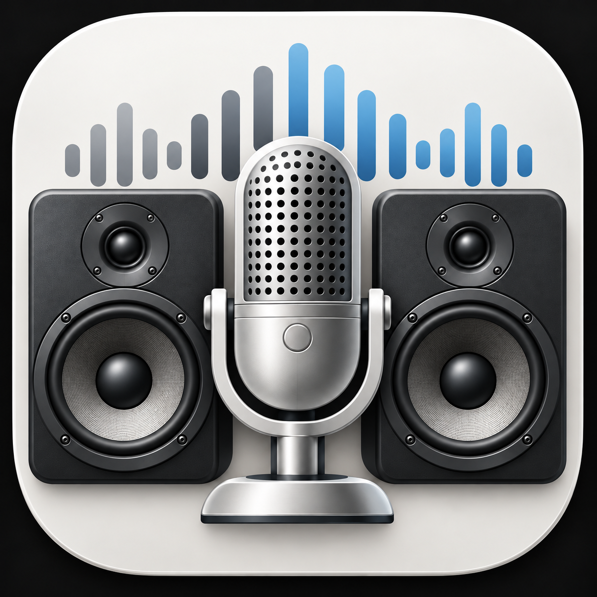

<p align="left"></p>

# volctl

This is a commandline tool to Get or Set the volume level for a macOS audio device. It also supports controlling the mute state.

In contrast to the often suggested `osascript -e "output volume of (get volume settings)"`, it supports both getting and setting precise floating point values such as `0.273`

**N.B.** Some devices are "hybrid" and register as both an Input and Output device. For such devices, an additional `type` argument can be supplied to indicate which level you intend to operate on.

```
Usage: volctl [-q] <command> [args]

Global options:
    -q, --quiet                    Suppress all stdout/stderr output

Commands:
    list                           List all audio devices (tab-separated)
    get <device> [type]            Get volume level for a device
    set <device> <level> [type]    Set volume level for a device (0.0-1.0)
    mute <device> [state] [type]   Control mute state; state is on|off|toggle

Notes:
    <device> can be an ID number or a string (partial match is ok)
    Device ID 0 selects the current default device (output unless [type] is input)
    When using a string to select device, the first matching device is used
    [type] is optional: input | output
      (if supplied, name matching is limited to devices supporting that direction)
```

If a device has multiple streams and they are set at different levels (e.g. L/R balance is not equal) then all levels will be output in tab-separated format.

Use device ID `0` with `get`, `set`, or `mute` to target the current macOS default device. The optional `input` or `output` type selects the direction; omitting it selects the default output. For example, `volctl get 0` and `volctl get 0 output` are equivalent.

The default is resolved once per invocation. This does not change which devices macOS uses as defaults, and the default output is not the separate system-sound/alert output. If the requested default is unavailable, the command fails rather than selecting another device. Default devices must still support the requested volume or mute operation.

The `get`, `set`, and `mute` commands return exit status `0` on success or `1` on failure. Quiet mode suppresses messages without changing the exit status.

### Installing

Download the latest [release](https://github.com/luckman212/volctl/releases) and place `volctl` in your `$PATH` somewhere. I suggest `/usr/local/bin`.

Or, to compile from source, clone the repo and run:

```
swiftc -O -o volctl volctl.swift
```

### Examples

```
# Read the default output or input level
volctl get 0
volctl get 0 input

# Set the default output or input level
volctl set 0 0.3
volctl set 0 0.5 input

# Toggle the default output's mute state or mute the default input
volctl mute 0 toggle
volctl mute 0 on input
```

```
$ volctl list
61  Output  Audioengine 2+
140 Output  DELL S2721QS
95  In/Out  Jump Desktop Audio
99  In/Out  Jump Desktop Microphone
134 Input   Logitech Webcam C925e
113 Output  Mac mini Speakers
103 In/Out  Microsoft Teams Audio
55  Output  RODE NT-USB
67  Input   RODE NT-USB
127 In/Out  ZoomAudioDevice
```

```
$ volctl get logi
0.8
```

```
$ DEBUG=true volctl set logi 0.65
Resolved 'logi' => Logitech Webcam C925e (id: 134)
Successfully set main volume to 0.65
```
